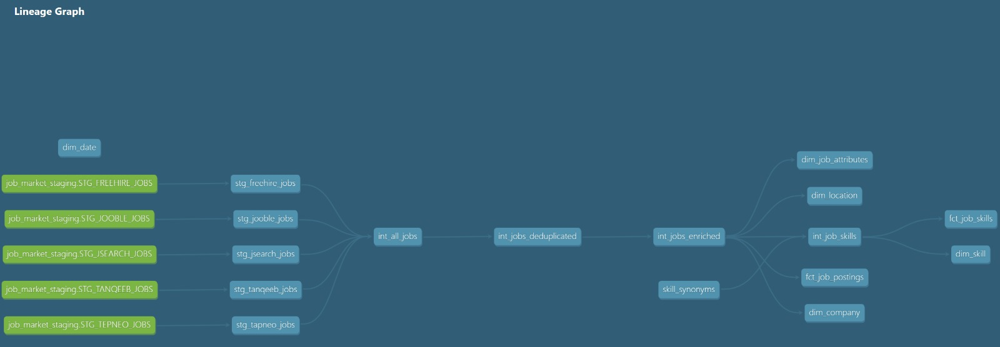
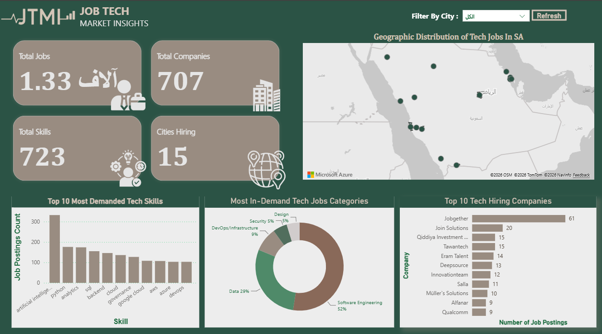

# Job Data Pipeline (Saudi Arabia Tech Market Analytics)

A modular, scalable, and collaborative data pipeline designed to collect, aggregate, and structure tech job market data across Saudi Arabia.

---

## 🏗️ Directory Structure

```
JobDataPipeline_Group03_v1/
├── 01_proposal/                
├── 02_code/  
|   |
│   ├── 01_data/                      
│   |    ├── final_datasets/       
│   |    └── data sample - raw data/ 
|   ├── 02_src/                      
│   |    ├── 01_Ingestion/   
|   |    |       |── freehire.py
|   |    |       |── jooble_api.py 
|   |    |       |── jsearch_api.py 
|   |    |       └── tanqeeb_scraper.py 
|   |    |
│   |    |── 02_initial_cleaning/       
│   |    |── 03_dbt_projects/       
│   |    |── 04_orchestrator/ 
|   |    └── .env
|   |
│   ├── 03_assets/
│   ├── README.md
│   └── requirements.txt
|   
├── 03_project_report/
└── 04_presentation
```

---

## 🛠️ Requirements

* Python 3.10+
* pip
* Git
* dbt with the Snowflake adapter (`dbt-snowflake`)
* Prefect 3.1.4+
* Internet connection
* Snowflake account and credentials
* Azure Blob Storage access
* API access for the required job-data sources

Python dependencies are listed in `requirements.txt`.
---

## 📋 Source Inventory & Selection Reasoning

We evaluated multiple job platforms to build a robust and comprehensive dataset for the Saudi technology market, and integrated 5 primary sources:

| Source | URL/Identifier | Collection Method | Format |
|:---:|:---:|:---:|:---:|
| **Tanqeeb** | https://saudi.tanqeeb.com | Web Scraping | JSON |
| **JSearch** | https://rapidapi.com/letscrape | API with Key | JSON |
| **FreeHire** | https://freehire.me/jobs | Direct Endpoint | JSON |
| **Tapneo** | https://tapneo-data.com | File-based source | CSV/JSON |
| **Jooble** | https://sa.jooble.org | API with Key | JSON |

### Selection Reasoning

* **Tanqeeb**: broad, localized coverage of the Saudi labor market as a prominent local platform with diverse listings.
* **JSearch API**: a reliable, managed REST API providing structured, consistent data, minimizing extraction errors and speeding up ingestion.
* **FreeHire**: specifically targets and enriches the dataset with technical job listings.
* **TapNeo**: a historical baseline for testing and for verifying the pipeline can import and integrate pre-existing files.
* **Jooble API**: regional and global scope, with accurate and continuously updated tech listings across the Kingdom via its official endpoint.

We implemented a multi-source hybrid extraction strategy combining structured API providers (Jooble, JSearch, FreeHire) with targeted web scraping (Tanqeeb) and file-based ingestion (Tapneo). This ensures broad coverage of tech job postings while avoiding platform limitations. Sources with heavy login walls or strict rate limits were dropped after initial access testing.

---

## 📐 Data Modeling & Star Schema Architecture

The Gold layer (`MARTS`) follows a classic Dimensional Modeling (Star Schema) to optimize analytical queries and dashboard performance:

* **Fact Job Postings** (`fct_job_postings`): one row per unique job posting, linked to conformed dimension keys.
* **Fact Job Skills / Bridge** (`fct_job_skills`): one row per (job posting, skill) pair, carrying conformed dimension keys for direct filtering without complex joins.
* **Dimensions** (`dim_*`): Company, Location, Date, Skill, and Job Attributes.

---

## 🗺️ dbt Documentation & Lineage Graph

dbt automatically generates an interactive documentation site and dependency graph, showing the flow from raw staging sources through intermediate deduplication/enrichment models to the final marts and facts.



### Generating Documentation Locally

```bash
cd 02_code/02_src/03_dbt_projects/job_pipeline_dbt
dbt docs generate
dbt docs serve
```

---

## 📊 Dashboard & Analytics Preview

An interactive Power BI dashboard was built on top of the final Star Schema marts.

👉 **[Explore Live Interactive Power BI Dashboard](https://app.powerbi.com/view?r=eyJrIjoiMTdiNGNiMDctMTU4MS00NDJlLTk4NjYtYWJhMWI5MzA5MzY1IiwidCI6ImMyYjA0ZGE2LTg0ODctNDFjYy04ODAzLTkwMzIxMDQ4YTc3MiIsImMiOjl9)**



---

## 📦 Final Datasets & Handover

Per our handover protocol, structured CSV exports of the final Mart tables are preserved under [01_data/final_datasets/](01_data/final_datasets/), with full schema documentation, to ensure longevity beyond temporary cloud trials.

---

## 🚀 Getting Started

### 1. Clone the Repository

```bash
git clone https://github.com/Leel15/DE-2026-TeamC-JobDataPipeline-Cohort-1.git
cd DE-2026-TeamC-JobDataPipeline-Cohort-1
```

### 2. Install Python Dependencies

```bash
pip install -r 02_code/requirements.txt
```

### 3. Configure Environment Variables

Create a `.env` file inside `02_code/02_src/ ` and fill in your credentials.
```
# Ingestion APIs
SCRAPEOPS_API_KEY=your_scrapeops_api_key
RAPIDAPI_KEY=your_rapidapi_key
JOOBLE_API_KEY=your_jooble_api_key

# Snowflake
SNOWFLAKE_USER=your_snowflake_username
SNOWFLAKE_PASSWORD=your_snowflake_password
SNOWFLAKE_ACCOUNT=your_snowflake_account
SNOWFLAKE_WAREHOUSE=COMPUTE_WH
SNOWFLAKE_DATABASE=JOB_MARKET_DB
SNOWFLAKE_SCHEMA=RAW

# Azure Blob Storage
AZURE_STORAGE_ACCOUNT=your_storage_account
AZURE_STORAGE_CONTAINER=your_storage_container
AZURE_SAS_TOKEN=your_sas_token
```

> 🔒 **Security:** Never commit `.env` or any API keys, passwords, tokens, or other credentials. `.env.example` must contain placeholders only.

### 4. Run Data Ingestion

From the project root, run each ingestion script individually:

```bash
cd 02_code
python 02_src/01_Ingestion/freehire.py
python 02_src/01_Ingestion/tanqeeb_scraper.py
python 02_src/01_Ingestion/jooble_api.py
python 02_src/01_Ingestion/jsearch_api.py
```

TapNeo is handled through file-based ingestion using the provided dataset. The ingestion layer collects source data and prepares it for downstream transformation.

### 5. Run Transformations with dbt

```bash
cd 02_code/02_src/03_dbt_projects/job_pipeline_dbt

dbt deps    # install dbt dependencies
dbt run     # build Staging, Intermediate, and Marts layers
dbt test    # run data quality tests
```

The dbt project transforms the ingested data through staging and intermediate models before producing the final analytical marts.

---
## Known Issues

- External APIs may have rate limits, quotas, or temporary availability issues.
- Scraped websites may change their page structure, which can affect the scraper.
- Job postings from different sources may contain duplicate or near-duplicate records.
- Running the full pipeline requires valid API keys and access to the configured Snowflake and Azure resources.
- Dashboard data freshness depends on the latest successful pipeline run.