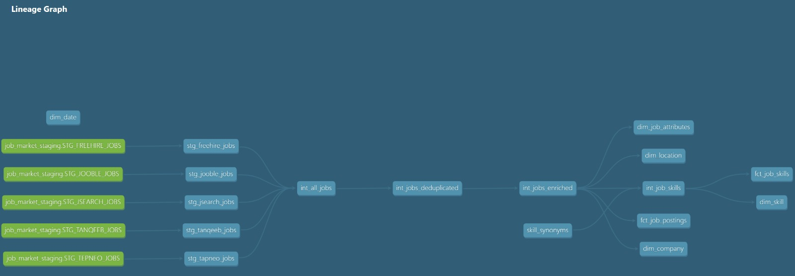
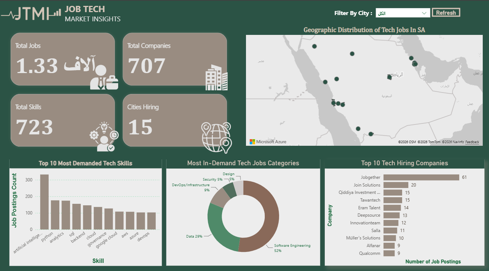

📊 Saudi Tech Job Market Analytics
One clean view of the Saudi tech job market, built from five messy sources

A team capstone from the Data Engineering Bootcamp by the Saudi Digital Academy (SDA) with WeCloudData (August 2026).

Show Image Show Image Show Image Show Image Show Image Show Image

📌 The problem

Tech job postings in Saudi Arabia are scattered across many platforms, each with its own format, language and data quality. That makes simple questions hard to answer: which skills are in demand, which cities are hiring, and which companies post the most roles.

💡 What we built

An automated end-to-end pipeline that collects postings from five sources, cleans and standardizes them, models them into a star schema on Snowflake, and serves insights through an interactive Power BI dashboard.

  

🔌 Sources
Source	Type	Challenge
Jooble	REST API	API key authentication
JSearch	RapidAPI	Header-based authentication
FreeHire	Web scraping	Dynamic pages
Tanqeeb	Web scraping	Arabic content, translated to English
Tapneo	Static files	Different structure from the APIs
⚙️ How it works
Extract: Python extractors pull postings from each source and land raw JSON in ADLS Gen2.
Load: New files are loaded into Snowflake RAW tables with COPY INTO, skipping files that were already loaded.
Clean: Python removes HTML from descriptions, extracts skills from free text, translates Arabic postings, and standardizes titles, locations and employment types. Loads are incremental, tracked with a watermark table.
Model: dbt moves the data through staging → intermediate → marts, deduplicates postings and normalizes skill names with a synonyms seed.
Orchestrate: A Prefect flow runs the whole pipeline end to end.
Serve: Power BI reads the marts to show the market.
🙋 My role: extraction and orchestration

I owned how data gets into the pipeline and how the pipeline runs:

Extraction. Built Python extractors for the API and scraping sources (Jooble, JSearch, FreeHire and Tanqeeb) on resilient HTTP sessions with automatic retries and timeouts, landing raw JSON in ADLS Gen2 partitioned as raw/<source>/ingest_date=YYYY-MM-DD/.
Orchestration. Built the Prefect flow job-data-pipeline that runs everything end to end: extract from four sources, COPY INTO Snowflake RAW, then incremental cleaning into staging, with task-level retries and run logs for every step.
Safe reruns. Designed the flow so running it twice never duplicates data: Snowflake skips files it already loaded, cleaning reads only rows newer than the last run, and a watermark table is updated after every successful run.
⭐ Data model

A fact constellation with 5 dimensions and 2 fact tables:

Dimensions: dim_company, dim_location, dim_date, dim_job_attributes, dim_skill
Facts: fct_job_postings (one row per posting) and fct_job_skills (one row per posting and skill)
Surrogate keys with dbt_utils.generate_surrogate_key(), and an unknown-member pattern so missing keys never break joins
not_null, unique, relationships and accepted_values tests across the layers

  

📈 Dashboard

  

📁 Repository
01_proposal/        project proposal
02_code/
  ├── 01_data/      raw samples + final datasets
  ├── 02_src/       ingestion, cleaning, dbt project, Prefect orchestrator
  └── 03_assets/    architecture, lineage and dashboard images
03_project_report/  full written report
04_presentation/    slides + demo video
👥 Team

Built by Team C, DE 2026 Cohort 1: Ghala Alsalem, Lamia Alsuhibani, Mohammed Alharbi and Muradi Almutairi.

Portfolio · LinkedIn · GitHub

